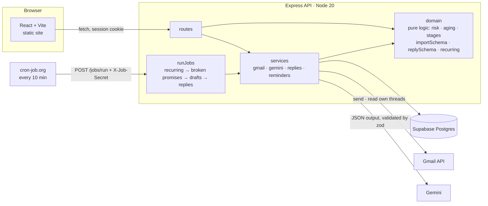

# Payment Reminder Agent

A payment reminder agent for anyone who is owed money — freelancers, agencies, landlords, retainer providers. It tracks what each customer owes, drafts a reminder at the right firmness for each stage, and **sends nothing until you approve it**. It reads the customer's reply, and when they promise to pay it pauses the reminders until that date.

Built for Brain³ (Level 1, Full Stack AI Web Developer). All data in this repo is invented.

**Live:** app — https://payment-reminder-agent-1.onrender.com · API — https://payment-reminder-agent.onrender.com ([`/health`](https://payment-reminder-agent.onrender.com/health))
(free tier: the first request after a quiet spell can take ~30–60 s while the API wakes up)

## Features

- **Customer risk score** — a rule-based `low` / `medium` / `high` label with a one-sentence reason, e.g. *“paid 3 of the last 3 invoices more than 14 days late, and has an invoice 45 days overdue.”* High-risk customers get a firmer tone at every stage.
- **Reply detection with promise-to-pay** — Gemini classifies each reply (promise to pay, dispute, already paid, other) and resolves dates like *“next Friday”*. A promise pauses that invoice's reminders until the date; a broken promise resumes them. Disputes and “already paid” claims are flagged for you — the agent never replies to them.
- **Overdue dashboard** — total owed and overdue, aging buckets (due soon, 1–7, 8–30, 30+ days), a “call first” list ranked by amount, and promises due this week.
- **Bulk CSV import with row-level validation** — upload, see every problem as *row · field · reason* (row numbers match your spreadsheet), then import all or only the valid rows. Nothing is saved before you confirm, and the import is a single transaction.
- **Approval queue** — every reminder is a draft you can edit; *Approve & send* sends it from your Gmail, later stages reply in the same thread, and a failed send can be retried.
- **Recurring billing** — rent and retainers generate one invoice per period on their billing day.

### Reminder stages

| Stage | When | Tone (high risk: one step firmer) |
|---|---|---|
| 1 | 3 days before the due date | friendly |
| 2 | 1 day after | friendly |
| 3 | 7 days after | firm |
| 4 | 14 days after | final |

Each stage is recorded once per invoice (`UNIQUE(invoice_id, stage)`), so reruns can never double-send, and a new stage is never drafted while the previous one is still waiting for you.

## Architecture



- **`server/src/domain`** — pure, unit-tested business logic (no DB, no network).
- **`server/src/services`** — Gmail, Gemini, reply detection, the send path (the *only* code that sends email).
- **`server/src/repos`** — plain SQL per table via `pg`; migrations in `server/migrations`.
- **`client/src`** — React pages: Dashboard, Customers, Import, Drafts, Replies, Login.

Safety rules the code enforces: no email without an approved draft; Gmail reading is limited to threads the app created; every Gemini answer is validated with zod and anything invalid becomes `needs_review`; if Gemini is down or rate-limited, reply detection pauses and nothing changes.

## Environment variables

Server — copy `server/.env.example` to `server/.env`:

| Variable | Purpose |
|---|---|
| `DATABASE_URL` | Postgres connection string (Supabase session pooler) |
| `TEST_DATABASE_URL` | A **separate** database for `npm test` — its tables are truncated |
| `APP_PASSWORD` | The single-user login password |
| `SESSION_SECRET` | Signs the session cookie (16+ random characters) |
| `JOB_SECRET` | Value of the `X-Job-Secret` header for `POST /jobs/run` |
| `GEMINI_API_KEY`, `GEMINI_MODEL` | Gemini key and model (a Flash / Flash-Lite model) |
| `GOOGLE_CLIENT_ID`, `GOOGLE_CLIENT_SECRET` | Google OAuth client (Gmail send + read, Sheets read-only) |
| `GOOGLE_REDIRECT_URI` | e.g. `http://localhost:4000/auth/google/callback` |
| `CLIENT_ORIGIN` | The frontend origin, for CORS, e.g. `http://localhost:5173` |
| `SENDER_NAME` | Name shown on outgoing reminders |
| `SEND_ALLOWLIST` | Optional, comma-separated. When set, *Approve & send* refuses any recipient not on the list (the live demo uses this so nobody can email a real address) |
| `PORT` | Defaults to 4000 |
| `SHEET_ID` | Reserved for an optional Google Sheet source (not used yet) |
| `DEMO_LIVE_EMAIL` | Demo seed only: the inbox you reply from in the demo |

Client — `client/.env`: `VITE_API_URL` (the API's URL). Secrets live only on the server; nothing sensitive is sent to the browser.

## Run locally

```bash
npm install
cp server/.env.example server/.env   # fill it in
npm run migrate                      # creates the tables
npm run dev                          # API on http://localhost:4000 (runs jobs every 10 min in dev)
npm run dev:client                   # UI on http://localhost:5173
```

Sign in with `APP_PASSWORD`, then use **Connect Gmail** on the dashboard. Optional demo data (replaces all customers/invoices/reminders/replies; keeps the Gmail connection):

```bash
npm run seed:demo            # dry run: shows what it would write
npm run seed:demo -- --yes   # writes it, then drafts due reminders with Gemini
```

`demo-import.csv` (8 rows, 3 planted errors) shows the import preview.

## Test

```bash
npm test                                   # unit + API tests (API tests need TEST_DATABASE_URL)
RUN_LIVE_AI=1 npm test -- replies.live     # classifies 20 invented replies with the real Gemini; passes at ≥ 18/20
```

The suite covers the import rules and transaction rollback, risk labels for 20 invented customers, dashboard totals from a hand-calculated fixture, every stage boundary, the send path with Gmail mocked (approve sends exactly once, reruns never duplicate drafts, a dispute never sends), Gemini fallbacks, and reply detection. Last live run: **20/20**.

## Deploy (Render free tier)

| | API — Web Service | UI — Static Site |
|---|---|---|
| URL | https://payment-reminder-agent.onrender.com | https://payment-reminder-agent-1.onrender.com |
| Root directory | repo root (the lockfile lives there) | repo root |
| Build | `npm ci --include=dev && npm run build -w server && npm run migrate:prod -w server` | `npm ci --include=dev && npm run build -w client` |
| Start / publish | `npm start -w server` | publish `client/dist` |
| Env | everything above (not `TEST_DATABASE_URL`, `DEMO_LIVE_EMAIL`, `PORT`) plus `NODE_ENV=production`, `GOOGLE_REDIRECT_URI=https://payment-reminder-agent.onrender.com/auth/google/callback`, `CLIENT_ORIGIN=https://payment-reminder-agent-1.onrender.com` | `VITE_API_URL=https://payment-reminder-agent.onrender.com` |
| Routing | health check `/health` | **Rewrite** (not Redirect) `/*` → `/index.html` |

`--include=dev` matters: Render installs with `NODE_ENV=production`, which would otherwise skip TypeScript. The production redirect URI is also added to the Google OAuth client.

In production the session cookie is `SameSite=None; Secure` (the UI and API are on different `onrender.com` subdomains), the app trusts Render's proxy, CORS only allows `CLIENT_ORIGIN`, and the in-process scheduler is off.

### Free-tier sleep, and the fix

A free Render web service sleeps after ~15 minutes without traffic, so an in-process timer would stop firing. Instead, **cron-job.org calls `POST https://payment-reminder-agent.onrender.com/jobs/run` every 10 minutes** with the `X-Job-Secret` header (timeout 60 s). The endpoint answers `202` right away and runs the checks in the background (an in-process lock refuses overlapping runs with `409`), so the scheduler never times out. The first call after a sleep wakes the service (a 30–60 s cold start); every run is logged in `job_runs`, and `GET /jobs/runs/latest` shows the last one.

## Scope and limits

- Single user (one password), one connected Gmail account.
- It reminds; it does **not** take payments or reconcile bank transactions — you mark invoices paid.
- Single currency per dashboard total; mixed currencies are shown side by side, never added together.
- Reply detection reads only the threads of reminders the app sent; replies outside those threads are not seen.
- Gemini can be slow or rate-limited on the free tier: drafting falls back to fixed templates, and reply detection pauses until the next run.
- The UI and API are on different domains, so the session cookie is a third-party cookie: it works in Chrome, Edge and Firefox; Safari's default tracking protection blocks it.
- Free tier sleeps (see above); the Google Sheet source (`SHEET_ID`) is not implemented.
